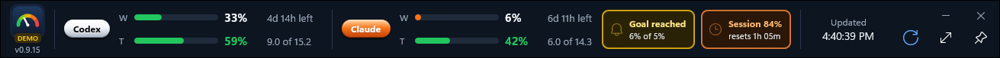
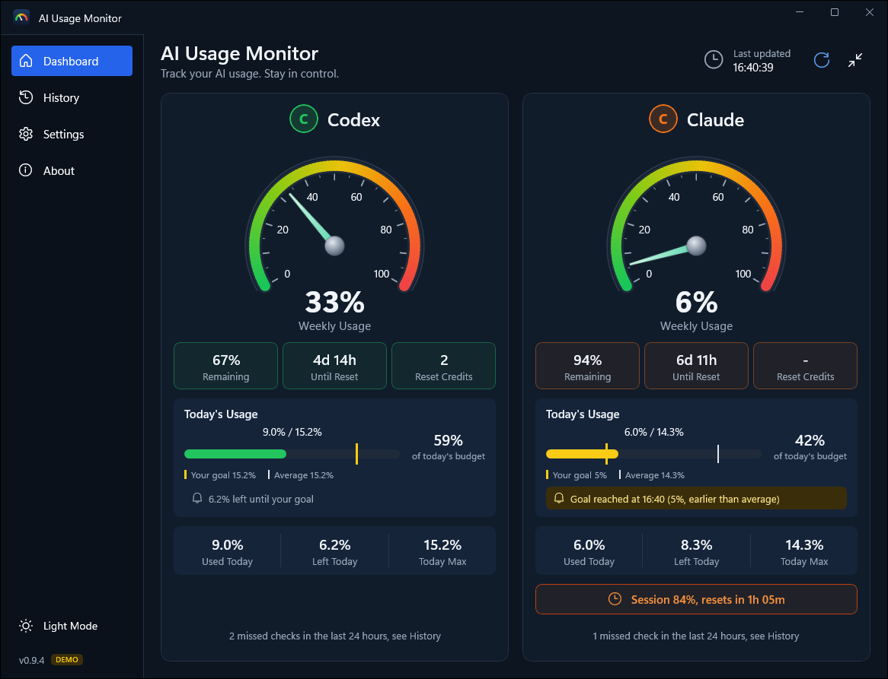
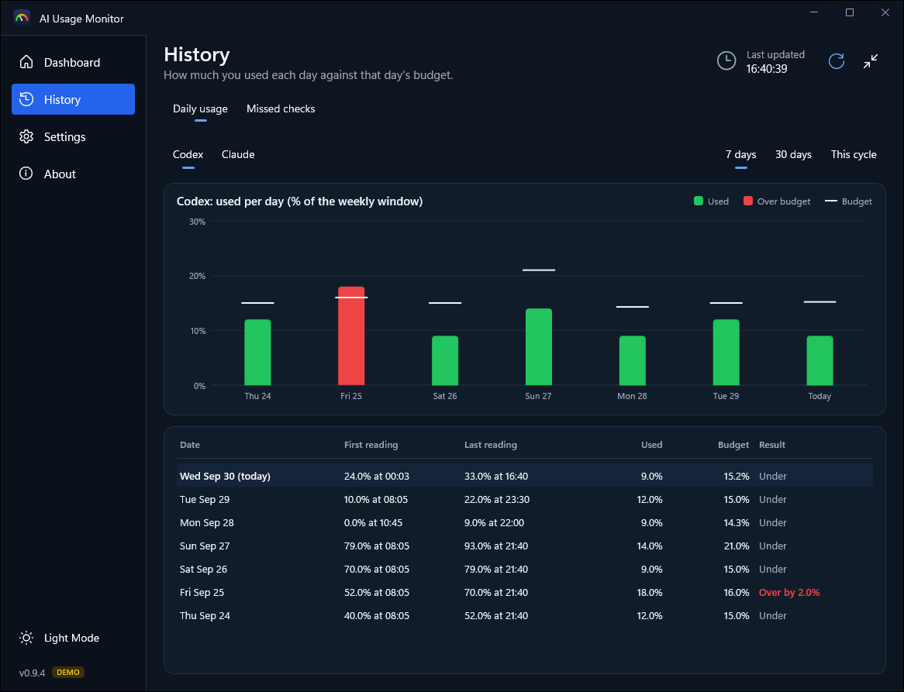
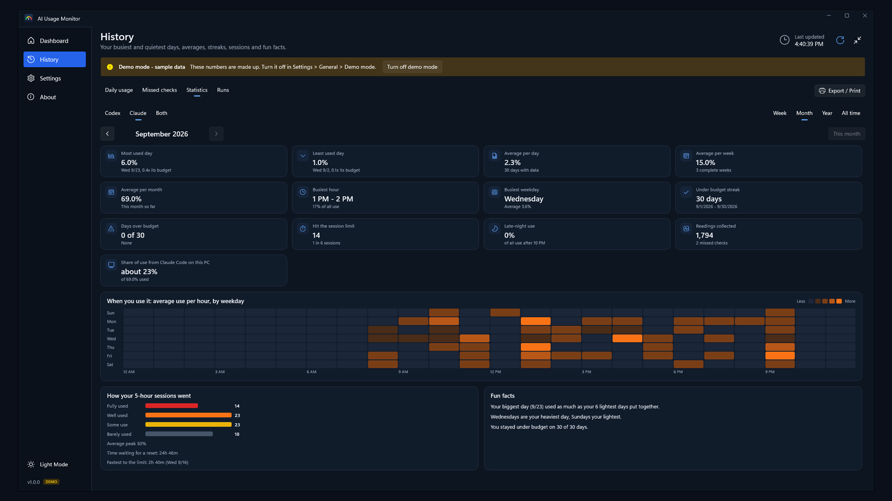
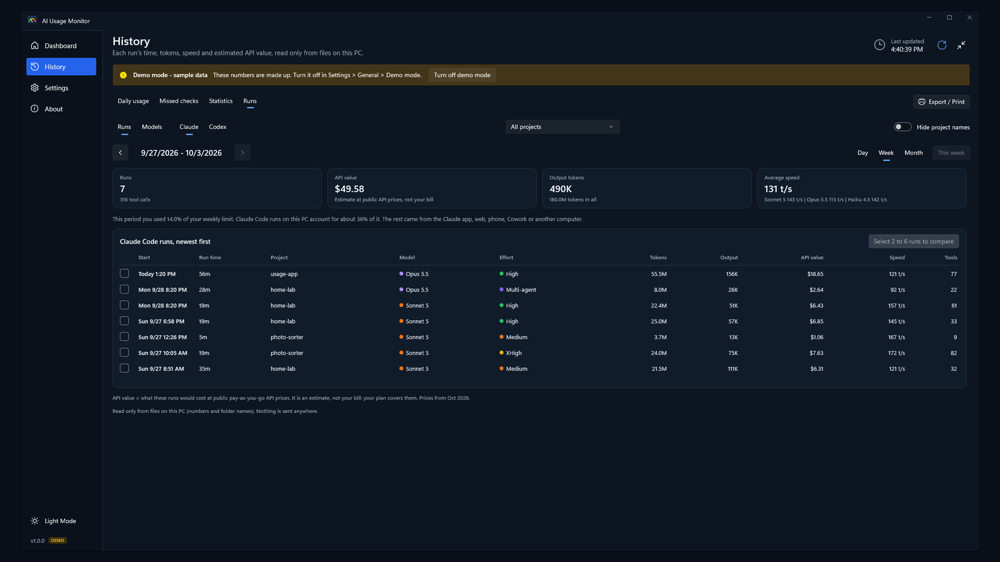
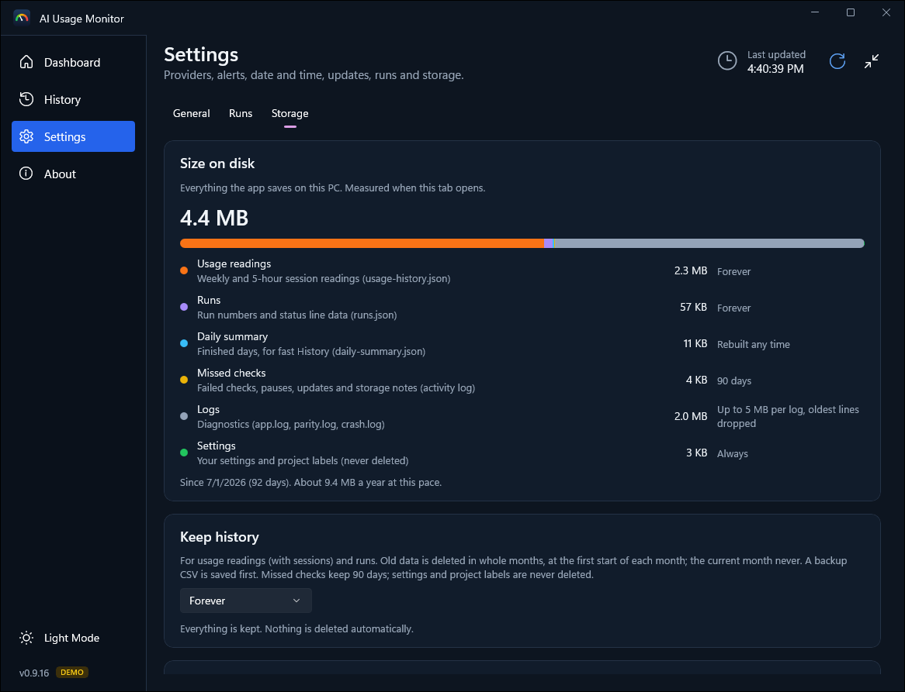

# AI Usage Monitor

A small Windows widget that shows how much of your **Claude Code** and **Codex** usage limits you've used this week, and how much you can use **today** so the week lasts until your limit resets.

This repository holds the installers, release notes and privacy policy. It contains no source code.

## What it shows

- **Weekly usage** and the time left until your limit resets.
- **Today's budget:** how much of the week you can use today, and how much of it you've used.
- **Claude's 5-hour session** usage, with an orange chip on the compact bar when it gets high.
- **Daily goal alerts:** set your own daily goal per tool. When you reach it, the app tells you once that day: a flashing bell on the compact bar, a Windows notification and, if you want, a sound.
- Made for people who use Codex and Claude Code. It shows coding-tool limits, not chat limits.
- ChatGPT chat usage isn't shown. OpenAI doesn't offer a way to read it, so the app can't.
- Claude chat (claude.ai and the Claude apps) shares the same limits as Claude Code, so your Claude numbers already include your chats.
- **History:** what you used each day against that day's budget. Move between weeks, months and years, or pick your own dates.
- **Day view:** every reading of a day on a 24-hour chart, with the hours that had no readings shaded. Click a day, a week or a month to open it.
- **5-hour sessions:** for each day, every Claude session with its peak, when it reached the limit and how long you waited for the reset (saved from 0.9.13 on). Codex doesn't report 5-hour sessions on this plan.
- **Statistics:** your busiest and quietest days, averages, streaks, when you use it (by weekday and hour), how your sessions went, and fun facts. For a week, a month, a year or all time.
- **Missed checks:** any checks that failed, with the reason.
- **Export** your history as a PDF report or CSV, or print it, also for a single day. Print or save sessions and statistics as PDF or CSV. Nothing leaves your computer; the file is saved where you choose.
- **New setting:** date and time format (24-hour or AM/PM), starts with your Windows setting.
- **Runs:** each Claude Code and Codex run with its time, tokens, speed and estimated **API value**, read only from the session files on your computer (numbers and folder names; never your prompts or code). Compare 2 to 6 runs, and see which models and effort levels used your tokens. "API value" is what a run would cost at public pay-as-you-go API prices: an estimate, not your bill.
- **Storage:** see how much space your history uses, keep it forever or for the last months or years, set a size limit, save a backup, and clear old months (a backup CSV of what is deleted is saved first).
- **Update check time:** choose when the app checks for a new version: morning, noon, evening or night (or off). It also checks at every start.

| Dashboard | History |
| --- | --- |
|  |  |

| Runs | Storage |
| --- | --- |
|  |  |

## Download

Get the latest version from the **[Releases page](https://github.com/rick-ronen/ai-usage-monitor-releases/releases/latest)**. Each release has:

| File | For |
| --- | --- |
| `AIUsageMonitor-Setup-X.Y.Z.exe` | Most people: installs for your Windows account only, no admin rights needed. |
| `AIUsageMonitor-Portable-X.Y.Z.zip` | PCs where an administrator installs software. Installs for all users in Program Files; the steps are in `WORK-LAPTOP-INSTALL.md` inside the ZIP. |
| `SHA256SUMS.txt` | SHA-256 checksums of both files. |

## Troubleshooting

- If Windows says 'This program does not support the version of Windows', open the Setup.exe from File Explorer instead of the browser, or turn off compatibility mode for your browser.

## System requirements

- Windows 10 (version 2004 or later) or Windows 11, 64-bit (x64).
- At least one of these, installed and signed in on the same Windows account:
  - **Claude Code**
  - **Codex** (the Codex app or the Codex CLI)
- Nothing else: .NET and the Windows App SDK are included.

The app reads usage from these coding tools only, not from the Claude or ChatGPT chat apps or websites. One of them is enough.

## How to install

1. Download `AIUsageMonitor-Setup-X.Y.Z.exe` from the Releases page.
2. Optional: check the file. In PowerShell, `Get-FileHash .\AIUsageMonitor-Setup-X.Y.Z.exe` must show the same SHA-256 as `SHA256SUMS.txt`.
3. Run it. The installer isn't code-signed yet, so Windows shows **"Windows protected your PC"** once: click **More info**, then **Run anyway**.
4. It installs to `%LOCALAPPDATA%\Programs\AIUsageMonitor` with Start menu and desktop shortcuts named **AI Usage Monitor** (from 1.0.0; an update removes the older shortcuts that had "(test)" in the name). Tick **Start when I sign in** if you want it to start with Windows (you can change that later in the app's Settings).

To uninstall: Windows Settings > Apps > Installed apps > **AI Usage Monitor** > Uninstall. Your settings and history are kept unless you tick **Remove my data too**.

## How updates work

- At every start, and once a day at the time you choose in **Settings > Updates** (morning, noon, evening or night, a few minutes later at random), the app asks GitHub for the number of the latest release in this repository. Nothing about you or your usage is sent. **Off** stops the daily check; the **Check for updates** button on the About page works either way.
- When a new version is out, a blue dot shows next to **About**. There is no popup.
- **Setup.exe installs:** **Download and install** downloads the new Setup.exe from this repository, checks it against `SHA256SUMS.txt`, closes the app for a few seconds while it installs, and opens it again. Your history and settings are kept. Nothing is installed without asking you.
- **All-users installs** (Program Files) can't update themselves. The app shows the download link to pass on to whoever installs software on that PC.

## Privacy

Everything stays on your PC. The app never asks for, reads or sends passwords, keys or tokens. Runs are read from Claude Code's and Codex's session files on your PC (numbers and folder names only) and never leave it. Details: [PRIVACY.md](PRIVACY.md).

## Feedback

Bugs, ideas, or anything you don't like: **aiusagemonitor.feedback@gmail.com**. The app's About page has a **Send feedback by email** button that fills in the app and Windows versions.

---

Not affiliated with or endorsed by OpenAI, Anthropic or any other AI company. Product names belong to their owners.

Product logos are not shown. The app uses its own badges and names the products in plain text, following the companies' brand rules.
